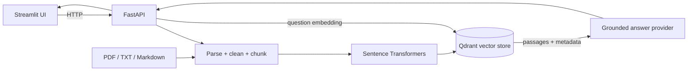

# Architecture

The same deterministic content hash is used for a document identity and deterministic point IDs for chunks. Each returned source is built from a retrieved Qdrant payload, so filenames and page numbers are never generated by the language model. When no LLM endpoint is configured, the app returns retrieved evidence and a setup hint instead of pretending to synthesize an answer.

## Persistence

Local mode stores Qdrant data under `DATA_DIR/qdrant`. Docker Compose uses a named volume. For a hosted demo, configure an external Qdrant URL and credentials; ephemeral container filesystems are not a durable document store. Keep an original, permission-cleared document collection so the index can be rebuilt.
